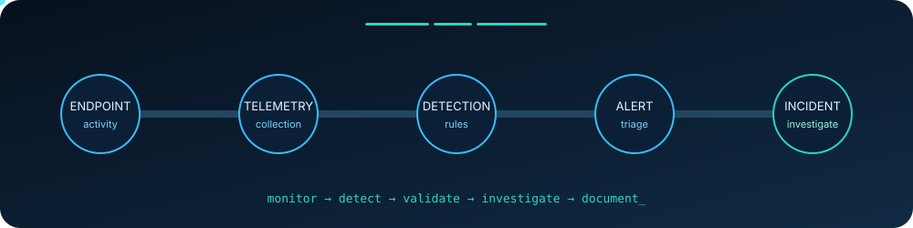
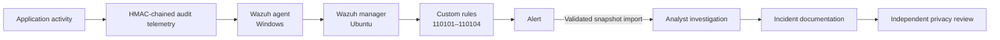
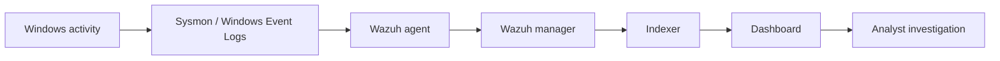

### Cybersecurity Student · Security Operations · Detection Engineering · Network & Cloud Security

University of South Florida cybersecurity student building defensive security projects around SIEM monitoring, endpoint telemetry, network analysis, phishing detection, and incident investigation. I connect security-relevant activity to auditable events, tested detections, analyst decisions, and documented outcomes.

📫 **sangampoudel642@gmail.com**

---

### Security Operations → Detection Engineering → Network Security → Cloud Security

| Current focus | Evidence |
|:---|:---|
| **Build secure, observable systems** | Flask application controls, structured audit telemetry, browser-local analysis |
| **Write and validate detections** | Custom Wazuh rules, regression fixtures, live lab alert validation |
| **Investigate before concluding** | Incident disposition, evidence references, privacy review, documented limitations |

---

## Flagship security work

  

### MediShield SOC — Healthcare Security Operations & Detection Engineering Lab

  

**Problem:** A valid employee login does not automatically authorize access to every patient record, and denied or abnormal access must become useful security evidence.

I built an isolated educational healthcare application using entirely synthetic data, then connected its security-relevant activity to tamper-evident audit records, custom Wazuh detections, analyst investigation, and an independent privacy-review workflow.

- **Security controls:** five role-specific workspaces, server-side RBAC and patient-level authorization, Argon2 password hashing, CSRF protection, and HMAC-chained, pseudonymized audit events
- **Detection engineering:** four custom Wazuh rules for denied patient access, canary-record access, disabled-account login, and application-calculated bulk access
- **Investigation evidence:** one documented true-positive detection of authorized testing, resolved as Incident #001 with a linked privacy review
- **Verification:** 52 tests reported passing in the documented Python 3.12 release run; Wazuh fixtures, `wazuh-logtest` workflow, live alert evidence, and sanitized screenshots are included
- **Stack:** Python, Flask, SQLAlchemy, SQLite, Windows, Ubuntu, Wazuh, PowerShell

[Repository](https://github.com/SangamBabuPoudel/MediShield-SOC) · [Architecture](https://github.com/SangamBabuPoudel/MediShield-SOC/blob/main/docs/architecture.md) · [Detection engineering](https://github.com/SangamBabuPoudel/MediShield-SOC/blob/main/docs/detection-engineering.md) · [Incident #001](https://github.com/SangamBabuPoudel/MediShield-SOC/blob/main/docs/incident-001.md)

> Architectural boundary: MediShield uses a human-initiated, validated alert-snapshot import; it does not claim a live Wazuh API integration or a production healthcare deployment.

### TrustTrace AI — Privacy-First Browser Phishing Detection

<table>
  <tr>
    <td width="50%"></td>
    <td width="50%"></td>
  </tr>
  <tr>
    <td align="center">Explainable browser-local risk summary</td>
    <td align="center">Pre-visit high-risk warning</td>
  </tr>
</table>

**Problem:** Phishing defenses need to identify deceptive URLs without treating every login page or brand mention as malicious—or unnecessarily transmitting browsing data.

I built a Chrome Manifest V3 extension with explainable, deterministic risk scoring for lookalike domains, punycode and homoglyph abuse, deceptive authentication URLs, suspicious redirects, fake login patterns, and clipboard risks.

- The published v1.0.0 branch performs core URL analysis locally in the browser and does not require the development FastAPI backend
- Domain-boundary validation prevents a trusted brand name in an attacker-controlled hostname, path, or query from receiving official-domain trust
- Warning pages, caution banners, search-result badges, Clipboard Guardian, and a local Security Report Card make findings actionable
- The release branch includes legitimate and adversarial regression fixtures covering major identity providers and deceptive lookalikes; its seven Node test groups pass across more than 50 URL cases
- **Stack:** JavaScript, Chrome Extension APIs, Manifest V3, HTML/CSS; Python/FastAPI remains in the development branch for local experimentation

[Repository](https://github.com/SangamBabuPoudel/TrustTraceAI) · [Chrome Web Store](https://chromewebstore.google.com/detail/trusttrace-ai/icodclconianombigcapccpilpnngjbg) · [Privacy design](https://github.com/SangamBabuPoudel/TrustTraceAI/blob/main/docs/privacy_design.md) · [Threat model](https://github.com/SangamBabuPoudel/TrustTraceAI/blob/main/docs/threat_model.md)

### Security Operations Home Lab — Endpoint Telemetry to Investigation

I use an isolated VMware lab to practice the full monitoring path rather than treating tools as standalone installations. Documented work includes Windows and Ubuntu systems, Sysmon and Windows Event Logs, a Wazuh agent/server pipeline, Event ID 7040 investigation, Nmap discovery, Wireshark packet analysis, and troubleshooting telemetry gaps.

> The home lab is currently documented in my [portfolio](https://sangam-dev.vercel.app); a dedicated public evidence repository is the next documentation step.

---

## Additional hands-on security work

| Area | Evidence and tools |
|---|---|
| **Security monitoring & detection** | Elastic Stack, Kibana/KQL, authentication-failure and brute-force detections, SIEM dashboards, MITRE ATT&CK mapping |
| **Network security monitoring** | Wireshark, Nmap/Zenmap, Snort, TCP/IP, DNS and HTTP packet analysis |
| **Digital forensics** | Volatility-based process, network-connection, persistence, and memory-image analysis |
| **Authorized security labs** | Hack The Box and TryHackMe exercises using Nmap/NSE, Burp Suite, Metasploit, Hashcat, John the Ripper, SMB/DNS enumeration, and injection concepts |

All offensive-security work is performed in authorized lab or course environments.

## Security stack

  
  
  
  
  
  

| Focus | Tools and technologies |
|---|---|
| **Security operations** | Wazuh, Sysmon, Elastic Stack, KQL, Windows Event Logs, MITRE ATT&CK |
| **Network security** | Wireshark, Nmap, Snort, TCP/IP, DNS, HTTP |
| **Security testing** | Burp Suite, Metasploit, Hashcat, John the Ripper |
| **Systems** | Windows, Linux/Ubuntu, VMware |
| **Development & automation** | Python, PowerShell, JavaScript, Flask, FastAPI, SQL, Git/GitHub |
| **Cloud — currently learning** | AWS IAM, least privilege, EC2, S3, CloudTrail, shared responsibility, cloud logging |

## Currently building

- Preparing for **CompTIA Security+ SY0-701** — in progress, expected Spring 2027
- Expanding detection engineering, incident investigation, and network engineering skills
- Developing AWS cloud security fundamentals with a long-term goal of adding evidence-backed cloud monitoring to MediShield
- Studying research fundamentals and literature related to uncertainty-aware LLMs and cybersecurity incident investigation

## Contribution activity

<picture>
  <source media="(prefers-color-scheme: dark)" srcset="https://raw.githubusercontent.com/SangamBabuPoudel/SangamBabuPoudel/output/github-contribution-grid-snake-dark.svg" />
  <source media="(prefers-color-scheme: light)" srcset="https://raw.githubusercontent.com/SangamBabuPoudel/SangamBabuPoudel/output/github-contribution-grid-snake.svg" />
  
</picture>

## Education

**University of South Florida**  
**B.S. Computer & Information Systems Security (Cybersecurity)** · Expected May 2028 · GPA: 3.77

- Green & Gold Presidential Scholar
- Dean's List
- Coursework includes Network Security, Intrusion Detection Systems, Malware Analysis, Digital Forensics, Penetration Testing, and Data Structures & Algorithms

---

Seeking cybersecurity, SOC, security analysis, detection engineering, network security, and cloud security internship opportunities.

